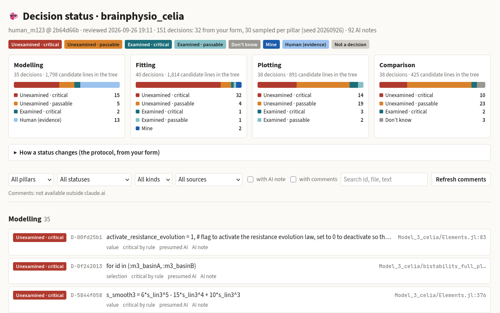

# brainchecker

brainchecker applies [PROTOCOL.md](PROTOCOL.md) to a modelling repository, one change at a time. The protocol says what counts as a decision, who owns it and what counts as examined; this README only covers running the tool.

Here is `git bc stage` on a staged change (brainphysio_celia's commit 5daa9896, re-staged on its parent):

```
$ git bc stage
brainchecker · staged change: 3 decisions — 2 unexamined · critical · 1 unexamined · passable
  (this report never blocks; Claude-written lines count as unexamined until you mark them)

UNEXAMINED · CRITICAL
  plotter/plot_runs.jl:69  [claim] # One canvas for every deck, patient decks included (1200×400 since the compare_ALL pass).
      by presumed AI · flag: a comment or docstring that states a number or a finding · reaches m1,m4; 0 decks
  plotter/plot_runs.jl:71  [value] const LW_SCALE   = PANEL_W / 600   # = 2.0 — for BLUE_REF_LW (M1's backdrop weight) only
      by presumed AI · flag: a comment or docstring that states a number or a finding · reaches m1,m4; 0 decks

unexamined · passable
  plotter/plot_runs.jl:70  [value] const PANEL_W    = 1200
      by presumed AI · reaches m1,m4; 0 decks

To mark one: put `# examined: <how you checked it>` or `# human: <why>` on or next to the line,
or comment on it on the site. Notes for critical decisions are written after the commit.
```

The pre-commit hook prints the same report on `git commit`. `./bc site` builds the status page, with every decision and a comment thread for each:



## Commands

Run these from this folder, with `./bc`. In the target repo, `git bc` does the same after `./bc install`.

| Command | What it does |
|---|---|
| `./bc review` | Audits the whole tree, then writes notes for the critical rows (automatic, see `[notes]`) |
| `./bc stage` | Reports on what is staged now (the pre-commit hook prints the same report) |
| `./bc record [SHA]` | Records one commit in the ledger (this is what the post-commit hook runs) |
| `./bc replay A..B` | Runs the per-change analysis over past commits; `--record` also writes them to the ledger |
| `./bc notes [--ids …]` | Writes consequence notes with Claude Code (`claude -p`, headless, no tools) |
| `./bc check ID` | Runs one registered check (`copy-drift`, `verify-fit-m5`, `m7-gate`, …) |
| `./bc comment ID "text" --kind examined` | Marks or comments on a decision from the terminal |
| `./bc sync-comments FILE` | Imports the website's comments (Claude exports them from the page's database) |
| `./bc site` | Builds `site/status.html` from the ledger |
| `./bc install` / `./bc uninstall` | Adds or removes the two hooks and the `git bc` alias in the target repo |

## Layout

```
brainchecker/        the package: rules, provenance, reach, evidence, note, checks, stage, review, ledger, site
targets/<name>/      target.toml (paths, path map, pairs, checks, reports), known.toml (the 32 form decisions),
                     the form answers
ledger/<name>/       decisions.json, comments.jsonl, STATUS.md, notes/, spend.jsonl, checks/   (tracked)
                     cache/ (transcript index, report text)                                    (ignored)
site/                the generated page, status.html (ignored); the template is brainchecker/site_template.html
tests/               python3 -m unittest discover tests
```

## Cost control

Notes are written by Claude Code, and each one's cost is logged in `spend.jsonl`. The costs are API-equivalent: on a claude.ai plan the calls draw on the plan's allowance, and a run that hits the usage limit stops cleanly. The settings are in `[notes]` in `targets/<name>/target.toml`:

| Setting | What it controls |
|---|---|
| `automatic` | Whether notes are written without being asked |
| `levels` | Which decisions get notes |
| `daily_cap_usd` | A daily spending cap; 0 means no cap |
| `per_call_budget_usd` | Passed to `claude --max-budget-usd` |
| `concurrency` | How many notes run at the same time |
